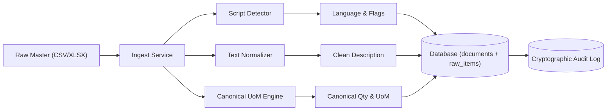

# Core Services Module (`api/services/`)

This directory contains the core domain services for text normalization, script detection, unit-of-measure conversions, and master data ingestion.

---

## 1. Purpose

The services in this directory process incoming raw procurement records before extraction, classification, and matching:
1. Identify script types and primary language per row.
2. Normalize descriptions, replace quotation variants, transliterate Indic trade loanwords, and expand abbreviations safely.
3. Convert non-standard units of measure into canonical units using physical equations and standard reference tables.
4. Parse bulk tabular data (CSV and XLSX) idempotently and store audit records.

---

## 2. Theory and Architecture



### 2.1 Unicode Script and Language Detection (`script_detector.py`)
- Reads Unicode code points to detect script types: Devanagari, Tamil, Bengali, Telugu, Gujarati, Kannada, Malayalam, Odia, Gurmukhi, and Latin.
- Flags descriptions that contain both Latin and Indic scripts with `MIXED_SCRIPT`.

### 2.2 Text Normalization Engine (`normalize.py`)
- Applies Unicode NFKC normalization.
- Converts double prime (`″`), typographical quotation marks (`”`, `“`), and consecutive single quotes (`''`) into standard double quotes (`"`).
- Converts prime (`′`) and typographical apostrophes (`’`, `‘`) into single quotes (`'`).
- Preserves Indic combining marks (matras) without destructive regex stripping.
- Preserves dimension multiplier `X` between numbers (for example, `50X50X6`).
- Transliterates Indic terms using per-language reference files. Unknown Indic tokens trigger the `UNKNOWN_INDIC_TOKENS` flag.
- Category-gated abbreviations:
  - Expands abbreviations only when the candidate category is known.
  - For `FASTENERS`, `STD` expands to `STUD` only when followed by a valid bolt size (such as `M16` or `1/2"`). When ambiguous, it adds `AMBIGUOUS_ABBREVIATION` and does not expand.
  - Enforces cross-sector token collision guards for `ROLL`, `BELT`, `ST`, `EP`, `T22`, `T91`, `T11`, `TUBE`, `I`, `R`, and `FC`.

### 2.3 Canonical Unit of Measure Engine (`uom.py`)
- Restricts units to a controlled vocabulary: `EA, SET, M, KM, KG, MT, LTR, PAIR, ROLL, DRUM, LOT, 100EA, FT`.
- Maps aliases (such as `NOS`, `PIECES`, `MTR`, `TONNES`) to controlled units.
- Converts dimensions to canonical base units:
  - Rebar linear mass: $kg/m = \frac{d^2}{162}$ (where $d$ is diameter in mm).
  - Structural steel profiles: lookup from IS 808 table in `dictionaries/section_properties.csv`.
  - Steel plates: $kg = thickness\_mm \times width\_m \times length\_m \times 7.85$.
  - Pipes: $kg/m = (OD - WT) \times WT \times 0.02466$.
- **Safety Rule:** When an equation requires a missing attribute, the engine raises `MissingConversionAttribute` and sets the `MISSING_CONVERSION_ATTRIBUTE` flag. It never invents or guesses numbers.

### 2.4 Tabular Ingestion Service (`ingest.py`)
- Reads CSV and XLSX files.
- Uses per-organisation column mapping profiles (`organizations.profile`).
- Stores the complete raw input verbatim in the `raw_payload` JSONB column.
- Guarantees idempotency using the SHA-256 file hash.
- Writes an audit log entry in the same transaction as the document and item records.

---

## 3. File Index

- [script_detector.py](file:///C:/Users/mayank/Developement/Projects/SamanvayAI/api/services/script_detector.py): Unicode script ranges and language identification.
- [normalize.py](file:///C:/Users/mayank/Developement/Projects/SamanvayAI/api/services/normalize.py): NFKC, quote mapping, Indic transliteration, and category-gated abbreviation expansion.
- [uom.py](file:///C:/Users/mayank/Developement/Projects/SamanvayAI/api/services/uom.py): Unit standardization and canonical physical conversions.
- [ingest.py](file:///C:/Users/mayank/Developement/Projects/SamanvayAI/api/services/ingest.py): File parsing, row-level validation, and transactional database storage.
- [__init__.py](file:///C:/Users/mayank/Developement/Projects/SamanvayAI/api/services/__init__.py): Module export interface.

---

## 4. Manual Testing Guide

Run these commands using `uv`:

### 4.1 Test Script Detection
```powershell
uv run python -c "from api.services.script_detector import detect_scripts; print(detect_scripts('वाल्व GATE VALVE'))"
```

### 4.2 Test Text Normalizer
```powershell
uv run python -c "from api.services.normalize import normalize_text; print(normalize_text('वाल्व 2″ SS 304 GT #150', category='VALVES'))"
```

### 4.3 Test Fasteners STD Rule
```powershell
uv run python -c "from api.services.normalize import normalize_text; print('With size:', normalize_text('HEX BOLT STD M16', category='FASTENERS').clean_text); print('Without size:', normalize_text('HEX BOLT STD', category='FASTENERS').clean_text, normalize_text('HEX BOLT STD', category='FASTENERS').flags)"
```

### 4.4 Test Canonical UoM Rebar Conversion
```powershell
uv run python -c "from api.services.uom import convert_to_canonical; print(convert_to_canonical(1000, 'M', category='REBAR', attributes={'diameter_mm': 12}))"
```

### 4.5 Test IS 808 Beam Mass Calculation
```powershell
uv run python -c "from api.services.uom import convert_to_canonical; print(convert_to_canonical(12, 'M', category='SECTIONS', attributes={'designation': 'ISMB 300'}))"
```

---

## 5. Connected Documentation

- [Root Architecture README](file:///C:/Users/mayank/Developement/Projects/SamanvayAI/README.md): High-level system design.
- [Extractor Framework README](file:///C:/Users/mayank/Developement/Projects/SamanvayAI/api/extractors/README.md): Attribute extraction and Spec Registry.
- [Dictionaries README](file:///C:/Users/mayank/Developement/Projects/SamanvayAI/dictionaries/README.md): Reference tables and dictionaries.
- [Routers README](file:///C:/Users/mayank/Developement/Projects/SamanvayAI/api/routers/README.md): HTTP endpoints.
- [Verification Register](file:///C:/Users/mayank/Developement/Projects/SamanvayAI/docs/verification.md): External standards tracking.

