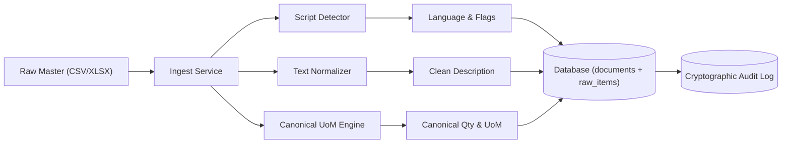

# Core Services Module (`api/services/`)

This directory contains the core domain services for text normalization, script detection, unit-of-measure conversions, and master data ingestion.

---

## 1. Purpose

The services in this directory process incoming raw procurement records before extraction, classification, and matching:
1. Identify script types and primary language per row.
2. Normalize descriptions, replace quotation variants, transliterate Indic trade loanwords, and expand abbreviations safely.
3. Convert non-standard units of measure into canonical units using physical equations and standard reference tables.
4. Parse bulk tabular data (CSV and XLSX) idempotently and store audit records.

---

## 2. Theory and Architecture



### 2.1 Unicode Script and Language Detection (`script_detector.py`)
- Reads Unicode code points to detect script types: Devanagari, Tamil, Bengali, Telugu, Gujarati, Kannada, Malayalam, Odia, Gurmukhi, and Latin.
- Flags descriptions that contain both Latin and Indic scripts with `MIXED_SCRIPT`.

### 2.2 Text Normalization Engine (`normalize.py`)
- Applies Unicode NFKC normalization.
- Converts double prime (`″`), typographical quotation marks (`”`, `“`), and consecutive single quotes (`''`) into standard double quotes (`"`).
- Converts prime (`′`) and typographical apostrophes (`’`, `‘`) into single quotes (`'`).
- Preserves Indic combining marks (matras) without destructive regex stripping.
- Preserves dimension multiplier `X` between numbers (for example, `50X50X6`).
- Transliterates Indic terms using per-language reference files. Unknown Indic tokens trigger the `UNKNOWN_INDIC_TOKENS` flag.
- Category-gated abbreviations:
  - Expands abbreviations only when the candidate category is known.
  - For `FASTENERS`, `STD` expands to `STUD` only when followed by a valid bolt size (such as `M16` or `1/2"`). When ambiguous, it adds `AMBIGUOUS_ABBREVIATION` and does not expand.
  - Enforces cross-sector token collision guards for `ROLL`, `BELT`, `ST`, `EP`, `T22`, `T91`, `T11`, `TUBE`, `I`, `R`, and `FC`.

### 2.3 Canonical Unit of Measure Engine (`uom.py`)
- Restricts units to a controlled vocabulary: `EA, SET, M, KM, KG, MT, LTR, PAIR, ROLL, DRUM, LOT, 100EA, FT`.
- Maps aliases (such as `NOS`, `PIECES`, `MTR`, `TONNES`) to controlled units.
- Converts dimensions to canonical base units:
  - Rebar linear mass: $kg/m = \frac{d^2}{162}$ (where $d$ is diameter in mm).
  - Structural steel profiles: lookup from IS 808 table in `dictionaries/section_properties.csv`.
  - Steel plates: $kg = thickness\_mm \times width\_m \times length\_m \times 7.85$.
  - Pipes: $kg/m = (OD - WT) \times WT \times 0.02466$.
- **Safety Rule:** When an equation requires a missing attribute, the engine raises `MissingConversionAttribute` and sets the `MISSING_CONVERSION_ATTRIBUTE` flag. It never invents or guesses numbers.

### 2.4 Tabular Ingestion Service (`ingest.py`)
- Reads CSV and XLSX files.
- Uses per-organisation column mapping profiles (`organizations.profile`).
- Stores the complete raw input verbatim in the `raw_payload` JSONB column.
- Guarantees idempotency using the SHA-256 file hash.
- Writes an audit log entry in the same transaction as the document and item records.

### 2.5 Deterministic Attribute Comparator (`comparator.py`)
- Compares requirement attributes with candidate attributes one by one.
- Returns clear verdicts for each attribute: `EXACT`, `MISSING`, `MISMATCH`, `UPGRADE`.
- Evaluates `when` condition gating: attributes that are inapplicable by design (such as `facing` when end connection is threaded, or `cement_class` on refractory bricks) evaluate to `EXACT` (inapplicable) instead of routing incorrectly to `MISSING`.
- Evaluates directional substitution lattices:
  - Hazardous area gas groups: $IIC \ge IIB \ge IIA$ (within Group II surface equipment).
  - Temperature classes: $T6 \ge T5 \ge T4 \ge T3 \ge T2 \ge T1$.
  - Motor energy efficiency: $IE4 > IE3 > IE2 > IE1 > EFF3$.
  - Transformer capacity: higher kVA is a candidate upgrade.
  - Circuit breaker breaking capacity: higher kA is a candidate upgrade.
  - Pressure class: higher class is NOT an upgrade because bolt patterns differ.
- Safety Rule ($S11$): Group I (mining) and Group II (surface) never equal and never substitute.

### 2.6 Safety Tiering Engine (`tiering.py`)
- Serves as the single authoritative decision point for harmonization tiers.
- Enforces Safety Invariants $S1$ to $S15$:
  - `Tier 1 (Auto-Harmonize)`: All HARD and REQUIRED attributes match exactly with high confidence ($P \ge \tau_{auto}$).
  - `Tier 2 (Steward Review)`: Incomplete attributes, directional upgrades, extraction flags, drawing revisions, or medium probability ($ \tau_{review} \le P < \tau_{auto} $).
  - `Tier 3 (Distinct)`: Any HARD attribute mismatch, OEM part number mismatch, or low probability ($P < \tau_{review}$).
- Enforces Stream A inventory pooling rules (lots with unknown or expired shelf-life are ineligible).
- Identity is never substitution: directional upgrades route to Tier 2 review.

### 2.7 Subcategory Classifier (`classify.py`)
- Classifies descriptions into one of the 21 domain material subcategories.
- Uses rule-based regex patterns, category hints, and token-centroid fallback similarity.
- Flags `CATEGORY_UNCERTAIN` when ambiguity occurs or top confidence is below threshold (0.50).
- Sets `MULTI_CATEGORY_MATCH` when multiple disjoint subcategories score equally high.
- Enforces Safety Invariant S3: Never force an uncertain category into Tier 1.

### 2.8 Candidate Retrieval Pipeline (`candidates.py`)
- Implements 4-stage prioritized candidate retrieval:
  1. Alias exact match (`alias_exact`).
  2. OEM part number exact match (`mpn_exact`).
  3. Blocking key match (`block_key = subcategory:size:rating:material`).
  4. Trigram fuzzy search within the same blocking block.
- Falls back to subcategory-wide search when the blocking key is partial, marking candidates with `PARTIAL_BLOCK`.
- Enforces strict candidate cap at 200 items to bound latency and compute.
- Supports both database queries (`retrieve_candidates_db`) and in-memory evaluation (`retrieve_candidates_in_memory`).

### 2.9 Calibrated Scorer (`scoring.py`)
- Computes 9 pairwise features between the requirement and candidate:
  1. `attr_agree_ratio`: Ratio of matching mandatory attributes.
  2. `n_missing`: Number of missing mandatory attributes.
  3. `n_mismatch`: Number of mismatched mandatory attributes.
  4. `trigram_sim`: Character trigram similarity between clean texts.
  5. `cosine_sim`: Alphanumeric token cosine similarity.
  6. `alnum_token_jaccard`: Alphanumeric token Jaccard similarity.
  7. `mpn_exact`: Binary indicator of OEM part number match.
  8. `alias_exact`: Binary indicator of catalog alias match.
  9. `extraction_conf_min`: Minimum extraction confidence across mandatory attributes.
- Uses logistic Sigmoid Platt calibration to compute continuous probability $P \in [0.0, 1.0]$.
- Enforces Safety Invariant S9: The probabilistic score can downgrade an item to Tier 2 or Tier 3. It can never promote an item with missing or mismatched attributes into Tier 1.

### 2.10 Golden Master Lifecycle Management (`lifecycle.py`)
- Manages Golden Master state transitions: `DRAFT` -> `ACTIVE` -> `DEPRECATED`.
- Generates permanent 17-character `MPNG-` codes protected by the Verhoeff check digit.
- Handles catalog consolidation operations:
  - `merge_golden_masters`: Merges a source master into a target master (`MERGED_INTO`), reassigning raw item links and aliases.
  - `split_golden_master`: Splits an over-merged master into distinct target masters (`SPLIT_INTO`).
  - `correct_master_attributes`: Corrects attributes of a master and creates a new immutable version.
- Transactional audit trail: Every lifecycle event writes an immutable audit record to `audit_log` in the same database transaction.

### 2.11 Cold-Start Deduplication Engine (`cold_start.py`)
- Processes legacy procurement catalogs without pre-existing golden records.
- Blocks raw items by `(subcategory, block_key)`.
- Clusters items with identical `HARD` and `REQUIRED` attribute signatures into proposed `DRAFT` golden masters.
- Calculates member provenance, aggregated stock quantities, and inventory value in INR.
- Identifies near-matches differing only by missing attributes and flags them for steward review (`needs_review`).
- Generates comprehensive Intra-Organisation Deduplication Reports in 80% ASD-STE100.

### 2.12 Stewardship Governance Engine (`stewardship.py`)
- Enforces Section 4.7 Maker-Checker operational governance ($Maker \ne Checker$).
- Supports 6 core stewardship proposal kinds: `LINK`, `CREATE_MASTER`, `MERGE`, `SPLIT`, `CORRECT_ATTR`, and `DOC_REVIEW`.
- Enforces Domain-Tag access controls: For `safety_critical` subcategories, the Checker must hold the domain tag of the subcategory's segment (`users.domains`); an unauthorized Checker cannot approve.
- Executes approved lifecycle mutations: links raw items, creates golden masters, merges/splits duplicate catalog entries.
- Captures human feedback: Every decision records a `FeedbackExample` row (`label=True` on approval, `label=False` on rejection) for downstream model calibration and dictionary suggestion.
- Transactional audit log: Every proposal, approval, and rejection records an immutable audit event in `audit_log` within the exact same database transaction.

---

## 3. File Index

- [comparator.py](file:///C:/Users/mayank/Developement/Projects/SamanvayAI/api/services/comparator.py): Deterministic attribute comparator and directional substitution lattices.
- [tiering.py](file:///C:/Users/mayank/Developement/Projects/SamanvayAI/api/services/tiering.py): Safety tiering engine and single authoritative point of truth for Tier 1.
- [stewardship.py](file:///C:/Users/mayank/Developement/Projects/SamanvayAI/api/services/stewardship.py): Maker-Checker task governance, domain-tag access controls, feedback capture, and audit logging.
- [classify.py](file:///C:/Users/mayank/Developement/Projects/SamanvayAI/api/services/classify.py): Subcategory classifier across 21 families with uncertainty flags.
- [candidates.py](file:///C:/Users/mayank/Developement/Projects/SamanvayAI/api/services/candidates.py): 4-stage candidate retrieval pipeline and blocking keys.
- [scoring.py](file:///C:/Users/mayank/Developement/Projects/SamanvayAI/api/services/scoring.py): 9-feature pairwise scorer with Platt calibration.
- [lifecycle.py](file:///C:/Users/mayank/Developement/Projects/SamanvayAI/api/services/lifecycle.py): Golden master lifecycle management, merging, splitting, and audit logging.
- [cold_start.py](file:///C:/Users/mayank/Developement/Projects/SamanvayAI/api/services/cold_start.py): Cold-start deduplication engine, clustering, and reporting.
- [script_detector.py](file:///C:/Users/mayank/Developement/Projects/SamanvayAI/api/services/script_detector.py): Unicode script ranges and language identification.
- [normalize.py](file:///C:/Users/mayank/Developement/Projects/SamanvayAI/api/services/normalize.py): NFKC, quote mapping, Indic transliteration, and category-gated abbreviation expansion.
- [uom.py](file:///C:/Users/mayank/Developement/Projects/SamanvayAI/api/services/uom.py): Unit standardization and canonical physical conversions.
- [ingest.py](file:///C:/Users/mayank/Developement/Projects/SamanvayAI/api/services/ingest.py): File parsing, row-level validation, and transactional database storage.
- [__init__.py](file:///C:/Users/mayank/Developement/Projects/SamanvayAI/api/services/__init__.py): Module export interface.

---

## 4. Manual Testing Guide

Run these commands using `uv`:

### 4.1 Test Subcategory Classifier
```powershell
uv run python -c "from api.services.classify import classify_text; res = classify_text('GATE VALVE 2 INCH 150# WCB FLANGED'); print('Subcat:', res.subcategory, 'Conf:', res.confidence, 'Flags:', res.flags)"
```

### 4.2 Test Blocking Key Generation
```powershell
uv run python -c "from api.services.candidates import compute_block_key; print('Block key:', compute_block_key('VALVES.GATE', {'size_nb': 50, 'pressure_class': 'ASME_150', 'body_material': 'A216_WCB'}))"
```

### 4.3 Test Calibrated Scoring
```powershell
uv run python -c "from api.services.scoring import score_candidate; from api.services.comparator import compare_items; comp = compare_items({'size_nb': 50, 'pressure_class': 'ASME_150'}, {'size_nb': 50, 'pressure_class': 'ASME_150'}, 'VALVES.GATE'); score = score_candidate('VALVE 2 INCH 150#', 'GATE VALVE 2 INCH 150#', comp, {'size_nb': 50, 'pressure_class': 'ASME_150'}, {'size_nb': 50, 'pressure_class': 'ASME_150'}); print('Calibrated prob:', score.probability)"
```

### 4.4 Test Attribute Comparison
```powershell
uv run python -c "from api.services.comparator import compare_items; res = compare_items({'size_nb': 100, 'pressure_class': 'ASME_150'}, {'size_nb': 100, 'pressure_class': 'ASME_300'}, 'VALVES.GATE'); print('Hard mismatch:', res.has_hard_mismatch)"
```

### 4.5 Test Directional Substitution Upgrade
```powershell
uv run python -c "from api.services.comparator import compare_items; res = compare_items({'gas_group': 'IIA', 'temp_class': 'T4'}, {'gas_group': 'IIC', 'temp_class': 'T6'}, 'MOTORS.EX'); print('Upgrade detected:', res.has_upgrade)"
```

### 4.6 Test Tiering Engine Decision
```powershell
uv run python -c "from api.services.comparator import compare_items; from api.services.tiering import assign_tier; comp = compare_items({'size_nb': 100, 'pressure_class': 'ASME_150'}, {'size_nb': 100, 'pressure_class': 'ASME_150'}, 'VALVES.GATE'); res = assign_tier(comp); print('Assigned Tier:', res.tier, 'Reasons:', res.reason_codes)"
```

### 4.7 Test Cold-Start Benchmark CLI
```powershell
### 2.12 OCR Provider Protocol and Gating (`ocr.py`)
- Defines `OCRProvider` protocol with implementations:
  - `FakeOCRProvider`: Deterministic sidecar JSON and synthetic line replay for CI.
  - `PyMuPDFProvider`: High-speed digital text layer and layout geometry extraction.
- **Safety Invariant $S5$:** Low-confidence OCR on HARD attributes becomes `None` with flag `LOW_OCR_CONFIDENCE`.

### 2.13 Document Intake Pipeline (`docs.py`)
- Multi-channel capture: `UPLOAD`, `CAMERA`, and `PASTE` (with `PASTED_TEXT` flag).
- **Safety Invariant $S10$:** Duplicate documents warn or block via SHA-256 file hash and normalized `invoice_key` (`<gstin>|<invoice_no>|<date>`). They never merge silently.
- Pre-procurement check (`precheck_document`): Checks existing golden masters to prevent duplicate procurement without persisting records, writing a cryptographic audit record.

### 2.14 MTC Certificate Engine (`mtc.py`)
- Extracts up to 17 chemistry elements (`C, Mn, Si, P, S, Cr, Ni, Mo, Cu, V, Nb, N, Al, W, Co, Ti, B`) with decimal comma normalization.
- Checks value bounds: values outside 0–100% or total sum > 100% become `None` with `CHEM_OUT_OF_RANGE`.
- Extracts mechanical properties (yield, tensile, elongation, hardness, Charpy energy).
- Computes derived formulas:
  - $CE_{IIW} = C + \frac{Mn}{6} + \frac{Cr + Mo + V}{5} + \frac{Ni + Cu}{15}$
  - $PREN = Cr + 3.3 \cdot Mo + 16 \cdot N$
- **Strict Rule:** Derived formulas compute ONLY when all constituents are present. Missing elements are never treated as zero; yields `CE_INCOMPLETE` or `PREN_INCOMPLETE`.
- **Safety Invariant $S15$:** MTC never yields `CONFORMS` against an unverified reference row (`UNVERIFIED_REFERENCE`). Lots are marked MTC-verified only with `CONFORMS` and a heat or batch number match.

### 2.15 Life Monitor Service (`life.py`)
- Pure functions using injectable `Clock` (`RealClock`, `SimulatedClock`). Domain functions never call `datetime.now()` directly.
- Multi-basis remaining life: `SHELF_LIFE_DAYS`, `USAGE_COUNT`, `USAGE_HOURS`. Earliest-ending basis wins ("6 months or 100 parts, whichever first").
- Risk states: `GREEN`, `AMBER`, `RED`, `EXPIRED`, `UNKNOWN`.
- **Safety Invariant $S6$:** Expired lot or unknown expiry on `expiry_required` subcategories is never `GREEN`, never Stream A eligible.
- **Safety Invariant $S7$:** Usage-based lot without usage events is never `GREEN` (`INSUFFICIENT_DATA` or `UNKNOWN`).
- **Safety Invariant $S8$:** Adding usage never increases remaining life; risk never improves as simulated time advances.
### 2.16 Observability and Prometheus Metrics Service (`observability.py`)
- Implements bounded-cardinality Prometheus metrics registry (`/metrics`) per Section 15.2.
- **Privacy Invariant:** Strictly prohibits tenant identifiers (`org_id`), user identifiers, item codes, or descriptions in Prometheus labels.
- Live system gauges collected without tenant leakage: review queue depth by domain, active RED risk lot count, queued job count, audit log record count, and SHA-256 chain verification status.

### 2.17 Catalog Health Scorecard Service (`health.py`)
- Calculates multi-factor item completeness per Section 20.1:
  $$\text{item\_completeness} = \frac{\sum \text{weight}(a) \text{ for applicable and unflagged}}{\sum \text{weight}(a)}$$
  with weights: $HARD = 2$, $REQUIRED = 1$, $SOFT = 0$.
- Evaluates attribute when-conditions (such as `form in [BRICK, PRECAST_SHAPE]`).
- Reports distinct, non-blended indicators: classified share, uncertain items count, extraction flag rates, duplicate rate, top missing attributes per subcategory, and statutory missing attributes.

### 2.18 OEM Catalogue Onboarding Service (`oem.py`)
- Ingests bulk OEM catalogue files and normalizes part numbers and manufacturer names.
- Traverses supersession mappings (`oem_part_supersessions`) to link older part numbers to effective superseding numbers.
- Creates draft master proposals under `OEM_PN` identity mode with character offset evidence spans.
- Enforces Maker-Checker dual governance ($Maker \ne Checker$) and domain-tag requirements before publishing golden masters and aliases.

### 2.19 Transactional Audit Helper (`audit.py`)
- Appends cryptographic SHA-256 hash-chain records to `audit_log` within the exact same database transaction as business state mutations.

### 2.20 Inter-CPSE Spare Locator Service (`locator.py`)
- Computes spherical great-circle distance between CPSE plant stores using the Haversine formula ($R = 6371\text{ km}$).
- Estimates road transit distance using $1.25 \times \text{great-circle distance}$.
- Filters lots to GREEN risk status and verified statutory compliance, obeying Invariants $S6$ and $S12$.
- Enforces Section 9.3 privacy disclosure masking: external CPSE rows reveal only golden code, descriptor, plant city, and stock quantity bucket (`LOW (<10)`, `MEDIUM (10-50)`, `HIGH (>50)`). Exact quantity and owner identity remain unmasked until a transfer request is approved.

### 2.21 Stream A Surplus Transfer Requisition Service (`transfer.py`)
- Manages inter-CPSE surplus stock transfer requisitions for Tier 1 identical items.
- Enforces Safety Invariant $S6$: expired lots or lots with unknown expiry on expiry-required classes cannot be transferred.
- Enforces Safety Invariant $S12$: missing statutory attributes block transfer eligibility.
- Implements the Section 13.0 economic value model:
  $$\text{net\_benefit} = \text{avoided\_purchase\_cost} - \text{transfer\_cost}$$
  where avoided cost equals quantity times current replacement cost, and transfer cost includes freight and inspection.
- Enforces Maker-Checker dual governance ($Maker \ne Checker$): requisition proposers cannot approve their own transfer orders.
- Writes cryptographic audit records to `audit_log` within the exact same database transaction.

### 2.22 Stream B Forward Demand Pooling and Tender Pack Service (`pool.py`)
- Manages forward demand indents across CPSE plants for active Golden Masters.
- Pools open indents into joint procurement Tender Pools and calculates multi-buyer discount curves:
  - `BULK_MT`: 5% at 50 MT, 8% at 200 MT, 12% at 500 MT, 15% at 1000+ MT.
  - `BULK_M`: 4% at 1000 M, 7% at 5000 M, 10% at 15000+ M.
  - `ENGINEERED`: 3% at 10 units, 6% at 50 units, 10% at 100+ units.
- Generates structured Tender Packs per Section 13.0 with parametric specifications, consignee allocation distribution tables, BIS/QCO and Make-in-India declarations, and exportable CSV BoQ summaries.

---

## 3. File Index

- [locator.py](file:///C:/Users/mayank/Developement/Projects/SamanvayAI/api/services/locator.py): Haversine distance calculator, plant mapping, and privacy disclosure masking.
- [transfer.py](file:///C:/Users/mayank/Developement/Projects/SamanvayAI/api/services/transfer.py): Stream A surplus transfer requisitions, value model, and Maker-Checker gate progression.
- [pool.py](file:///C:/Users/mayank/Developement/Projects/SamanvayAI/api/services/pool.py): Stream B demand pooling, discount scenarios, and structured Tender Pack generation.
- [observability.py](file:///C:/Users/mayank/Developement/Projects/SamanvayAI/api/services/observability.py): Prometheus metrics registry with strict privacy label guards.
- [health.py](file:///C:/Users/mayank/Developement/Projects/SamanvayAI/api/services/health.py): Multi-factor catalog health scorecard and non-blended metrics.
- [oem.py](file:///C:/Users/mayank/Developement/Projects/SamanvayAI/api/services/oem.py): OEM catalogue onboarding, part normalization, supersessions, and Maker-Checker approval.
- [audit.py](file:///C:/Users/mayank/Developement/Projects/SamanvayAI/api/services/audit.py): Transactional audit logging helper.
- [comparator.py](file:///C:/Users/mayank/Developement/Projects/SamanvayAI/api/services/comparator.py): Deterministic attribute comparator and directional substitution lattices.
- [drawing.py](file:///C:/Users/mayank/Developement/Projects/SamanvayAI/api/services/drawing.py): Drawing number normalization, key derivation, and Maker-Checker revision equivalence management.
- [tiering.py](file:///C:/Users/mayank/Developement/Projects/SamanvayAI/api/services/tiering.py): Safety tiering engine and single authoritative point of truth for Tier 1.
- [stewardship.py](file:///C:/Users/mayank/Developement/Projects/SamanvayAI/api/services/stewardship.py): Maker-Checker task governance, domain-tag access controls, feedback capture, and audit logging.
- [classify.py](file:///C:/Users/mayank/Developement/Projects/SamanvayAI/api/services/classify.py): Subcategory classifier across 21 families with uncertainty flags.
- [candidates.py](file:///C:/Users/mayank/Developement/Projects/SamanvayAI/api/services/candidates.py): 4-stage candidate retrieval pipeline and blocking keys.
- [scoring.py](file:///C:/Users/mayank/Developement/Projects/SamanvayAI/api/services/scoring.py): 9-feature pairwise scorer with Platt calibration.
- [lifecycle.py](file:///C:/Users/mayank/Developement/Projects/SamanvayAI/api/services/lifecycle.py): Golden master lifecycle management, merging, splitting, and audit logging.
- [cold_start.py](file:///C:/Users/mayank/Developement/Projects/SamanvayAI/api/services/cold_start.py): Cold-start deduplication engine, clustering, and reporting.
- [script_detector.py](file:///C:/Users/mayank/Developement/Projects/SamanvayAI/api/services/script_detector.py): Unicode script ranges and language identification.
- [normalize.py](file:///C:/Users/mayank/Developement/Projects/SamanvayAI/api/services/normalize.py): NFKC, quote mapping, Indic transliteration, and category-gated abbreviation expansion.
- [uom.py](file:///C:/Users/mayank/Developement/Projects/SamanvayAI/api/services/uom.py): Unit standardization and canonical physical conversions.
- [ingest.py](file:///C:/Users/mayank/Developement/Projects/SamanvayAI/api/services/ingest.py): File parsing, row-level validation, and transactional database storage.
- [ocr.py](file:///C:/Users/mayank/Developement/Projects/SamanvayAI/api/services/ocr.py): OCR provider protocol, PyMuPDF, and low-confidence gating.
- [docs.py](file:///C:/Users/mayank/Developement/Projects/SamanvayAI/api/services/docs.py): Multi-channel document intake and precheck.
- [mtc.py](file:///C:/Users/mayank/Developement/Projects/SamanvayAI/api/services/mtc.py): MTC certificate parser, chemistry bounds, CE/PREN, and reference verification.
- [life.py](file:///C:/Users/mayank/Developement/Projects/SamanvayAI/api/services/life.py): Life monitor, multi-basis remaining life, risk evaluation, and FEFO ladder.
- [__init__.py](file:///C:/Users/mayank/Developement/Projects/SamanvayAI/api/services/__init__.py): Module export interface.


- [Root Architecture README](file:///C:/Users/mayank/Developement/Projects/SamanvayAI/README.md): High-level system design.
- [Extractor Framework README](file:///C:/Users/mayank/Developement/Projects/SamanvayAI/api/extractors/README.md): Attribute extraction and Spec Registry.
- [Routers README](file:///C:/Users/mayank/Developement/Projects/SamanvayAI/api/routers/README.md): HTTP endpoints including `/compare`, `/tier`, and `/match`.
- [Tests README](file:///C:/Users/mayank/Developement/Projects/SamanvayAI/tests/README.md): Safety invariant test suite.
- [Dictionaries README](file:///C:/Users/mayank/Developement/Projects/SamanvayAI/dictionaries/README.md): Reference tables and dictionaries.
- [Verification Register](file:///C:/Users/mayank/Developement/Projects/SamanvayAI/docs/verification.md): External standards tracking.

