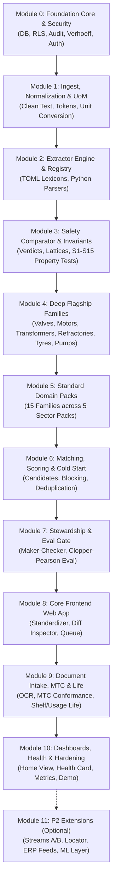

# Samanvay: Master Implementation Plan

This document defines the complete engineering and implementation plan for **Samanvay** (SIH26099: AI-Driven Standardization and Harmonization of Material Codes Across CPSEs).

This project follows three core principles:
1. **Module-Driven Development (MDD):** Build each module completely (data schema, logic, tests, seed fixtures, documentation) before you start the next module.
2. **Spec-Driven Development (SDD):** The document [specsheet.md](file:///C:/Users/mayank/Developement/Projects/SamanvayAI/specsheet.md) is the single source of truth. Never invent external facts. Obey all safety invariants ($S1$ to $S15$).
3. **Skill-Driven Development (SkDD):** Use the specialized skills in [.agents/skills/](file:///C:/Users/mayank/Developement/Projects/SamanvayAI/.agents/skills) for every operation. Do not guess or duplicate tools when a skill exists.

---

## 1. Documentation Standard (ASD-STE100 & Cross-Linking)

To make technical procedures easy to comprehend and maintain across sessions, all documentation in this repository must obey these rules:

1. **80% ASD-STE100 (Simplified Technical English):**
   - Write short sentences (fewer than 20 words where possible).
   - Use active voice and direct verbs (for example: *Run the test*, *Verify the output*, *Do not edit applied migrations*).
   - Use simple words. Do not use complex jargon when a simple word exists.
   - Maintain consistent nomenclature (use *test*, not *assay* or *check* interchangeably).
   - Clearly state conditions before actions (*If the verification fails, stop the pipeline*).
2. **Folder-Level Documentation Structure:**
   Every directory created in the repository must contain a beginner-friendly `README.md` that contains:
   - **Purpose:** What this directory contains and why it exists.
   - **Theoretical Background:** Clear conceptual explanation of the domain logic (for example: how Verhoeff check digits work, how pipe nominal bores relate to outer diameter).
   - **File Index:** Description of each file and its responsibilities.
   - **Manual Testing Guide:** Exact terminal commands and steps for a developer to test the code manually.
   - **Connected Documentation:** Hyperlinks to related `README.md` files (parent directories, caller modules, and dependent services).
3. **Hyperlink Integrity:**
   - Use clickable markdown links with the `file:///` URI scheme for files and code anchors.

---

## 2. Cross-Module Modification Protocol ("Extreme Caution")

When developing Module $N$ requires a modification to an earlier Module $M$ ($M < N$), you must execute the **Extreme Caution Protocol**:

```
[Need Change in Module M]
       |
       v
1. Check Invariants S1-S15 (samanvay-safety-review)
       |
       v
2. Never Mutate Applied Migrations (db-migration rule)
       |
       v
3. Run Hypothesis Property Suite (300+ examples)
       |
       v
4. Run Deliberate Mutation Test (safety-tests)
       |
       v
5. Verify Full Suite & Pack Isolation (make check & make test-pack)
       |
       v
6. Record Rationale in docs/decisions.md & docs/open-questions.md
```

1. **Safety Invariants Check:**
   - Run the checklist from [.agents/skills/samanvay-safety-review](file:///C:/Users/mayank/Developement/Projects/SamanvayAI/.agents/skills/samanvay-safety-review/SKILL.md).
   - Ensure the change does not violate invariants $S1$ to $S15$. Run `python scripts/scan_tier1.py` to confirm Tier 1 auto-harmonization logic is untouched.
2. **Database Immutability Check:**
   - Obey [.agents/rules/migrations.md](file:///C:/Users/mayank/Developement/Projects/SamanvayAI/.agents/rules/migrations.md).
   - Never edit an applied migration file. Always write a new, sequential migration file.
   - Maintain append-only audit triggers and tenant-isolated Row-Level Security (RLS).
3. **Hypothesis Property Test Run:**
   - Run the full suite using [.agents/skills/safety-tests](file:///C:/Users/mayank/Developement/Projects/SamanvayAI/.agents/skills/safety-tests/SKILL.md).
   - Must execute at least 300 test examples per invariant with zero failures.
4. **Mutation Verification:**
   - Execute the mutation test: deliberately weaken Tier 1 gating and confirm that the test suite fails. Restore the code afterward.
5. **Pack Isolation Verification:**
   - Run `make test-pack PACK=<pack>` for all packs.
   - Verify that removing or modifying any one pack does not break core or other packs.
6. **Documentation:**
   - Record the decision and justification in `docs/decisions.md`.
   - If an invariant or requirement conflicts, write the conflict in `docs/open-questions.md` and pause execution.

---

## 3. High-Level Dependency Graph



---

## 4. Module Specifications and Build Order

### Module 0: Foundation Core, Security & Data Persistence
- **Priority:** `[P0]`
- **Spec Sections:** `0.1`, `3.0`, `9.1`–`9.5`, `22.1`–`22.5`
- **Purpose:** Setup repository scaffold, database container, schema migrations, Row-Level Security, tamper-evident audit log, opaque national codes, and authentication.
- **Deliverables:**
  - Directory structure: `api/`, `db/migrations/`, `packs/`, `docs/`, `scripts/`, `web/`.
  - `docker-compose.yml` with PostgreSQL 18, `pgvector`, `pg_trgm`, `pgcrypto`, and `btree_gin`.
  - Database schema: `organizations`, `users`, `golden_masters`, `golden_aliases`, `manufacturers`, `documents`, `doc_lines`, `raw_items`, `match_candidates`, `steward_tasks`, `feedback_examples`, `jobs`, `attribute_specs`, `subcategory_specs`.
  - RLS policies by `app.current_org` failing closed.
  - Append-only audit trigger on `audit_log` with SHA-256 hash chaining using `pg_advisory_xact_lock(727001)`.
  - Python standard-library implementation of Verhoeff check digit (`MPNG-` 17-character opaque code).
  - JWT HS256 auth middleware and demo token generator script.
  - Seed data with at least four organisations across four sectors (`OIL-1`, `POWER-1`, `STEEL-1`, `MINE-1`).
- **Governing Skills:**
  - [.agents/skills/samanvay-core-utils](file:///C:/Users/mayank/Developement/Projects/SamanvayAI/.agents/skills/samanvay-core-utils/SKILL.md) (`verhoeff.py`, `hashchain.py`).
  - [.agents/skills/db-migration](file:///C:/Users/mayank/Developement/Projects/SamanvayAI/.agents/skills/db-migration/SKILL.md) & [.agents/rules/migrations.md](file:///C:/Users/mayank/Developement/Projects/SamanvayAI/.agents/rules/migrations.md).
  - [.agents/skills/stdlib-first](file:///C:/Users/mayank/Developement/Projects/SamanvayAI/.agents/skills/stdlib-first/SKILL.md).
  - [.agents/skills/modern-python](file:///C:/Users/mayank/Developement/Projects/SamanvayAI/.agents/skills/modern-python/SKILL.md).
  - [.agents/skills/verify-claims](file:///C:/Users/mayank/Developement/Projects/SamanvayAI/.agents/skills/verify-claims/SKILL.md).
- **Acceptance Gate:**
  - `make db-reset && make migrate` completes without error from empty state.
  - Audit tests pass: UPDATE, DELETE, and TRUNCATE raise exceptions; tamper detection catches altered rows.
  - RLS isolation tests pass across four tenant orgs.
  - Table-driven Verhoeff test vector suite passes 100% of single-digit and adjacent transposition mutations.

---

### Module 1: Ingestion, Text Normalization & Unit of Measure (UoM)
- **Priority:** `[P0]`
- **Spec Sections:** `4.1`, `4.2`, `7.6`, `18.3`, `18.9`
- **Purpose:** Parse raw descriptions from diverse ERP formats, clean text without losing semantic script markers, expand abbreviations safely, and normalize units of measure.
- **Deliverables:**
  - CSV/XLSX parser with per-organisation mapping profile (`raw_payload` JSONB retained, idempotent by file hash).
  - Multi-script Unicode detector (Devanagari, Tamil, Bengali, Telugu, Latin) and transliteration engine.
  - Normalizer: NFKC normalization, quote standardisation (`"`, `'`), case folding, and category-gated abbreviation expansion.
  - Cross-sector collision table: prevents incorrect token expansion across industry contexts (`ROLL`, `EP`, `ST`, `T22`).
  - Canonical UoM engine: converts section/rebar to `MT`, cables/pipes to `M`, equipment to `EA`.
  - Guard: raises `MissingConversionAttribute` instead of guessing when formula parameters are absent.
- **Governing Skills:**
  - [.agents/skills/stdlib-first](file:///C:/Users/mayank/Developement/Projects/SamanvayAI/.agents/skills/stdlib-first/SKILL.md) (`unicodedata`, `re`, `fractions`, `decimal`).
  - [.agents/skills/verify-claims](file:///C:/Users/mayank/Developement/Projects/SamanvayAI/.agents/skills/verify-claims/SKILL.md) (IS 808 density and formulas).
  - [.agents/skills/phase-gate](file:///C:/Users/mayank/Developement/Projects/SamanvayAI/.agents/skills/phase-gate/SKILL.md).
- **Acceptance Gate:**
  - Table-driven normalizer tests preserve Indic combining marks.
  - Ingestion idempotency verified on duplicate file hashes with row-level error reporting.
  - UoM conversion tests confirm `MissingConversionAttribute` is raised when dimensions are missing.

---

### Module 2: Extractor Framework & Spec Registry
- **Priority:** `[P0]`
- **Spec Sections:** `5.0`, `5.3`, `7.0`, `7.1`, `18.1`
- **Purpose:** Build the extensible attribute extraction framework to extract typed attributes, confidence scores, evidence spans, and warning flags from descriptions.
- **Deliverables:**
  - `ExtractedValue` dataclass: `(value, confidence, source, evidence_span, flags)`.
  - Standard-library TOML lexicon extractor engine (matches token boundaries, prefers longest synonyms).
  - Category-gated Spec Registry loading YAML/TOML specs from `packs/<pack>/specs/`.
  - Identity mode support: `PARAMETRIC`, `OEM_PN`, and `DRAWING`.
  - Core Python parsers: Piping Size to NB (Fraction + inch/mm mapping) and Pressure Class (ASME vs PN separation).
- **Governing Skills:**
  - [.agents/skills/samanvay-extractor-builder](file:///C:/Users/mayank/Developement/Projects/SamanvayAI/.agents/skills/samanvay-extractor-builder/SKILL.md) (`extract_base.py`, `pressure_class.py`).
  - [.agents/skills/stdlib-first](file:///C:/Users/mayank/Developement/Projects/SamanvayAI/.agents/skills/stdlib-first/SKILL.md).
  - [.agents/skills/phase-gate](file:///C:/Users/mayank/Developement/Projects/SamanvayAI/.agents/skills/phase-gate/SKILL.md).
- **Acceptance Gate:**
  - Spec registry loads all sector pack specifications without schema errors.
  - Size parser passes all spec test cases (`1-1/2"`, `DN150`, `SCH 40 6"`, `STUD M24X150MM` returning no size).
  - Every extracted value contains accurate character evidence spans on raw input.

---

### Module 3: Safety Comparator, Tiering Engine & Safety Invariants Suite
- **Priority:** `[P0]`
- **Spec Sections:** `4.6`, `5.1`, `5.2`, `5.4`, `6.0`
- **Purpose:** The safety core of the system. Compares items deterministically by attribute, evaluates directional lattices, and strictly enforces invariants $S1$ to $S15$.
- **Deliverables:**
  - Comparator returning attribute verdicts: `EXACT`, `MISSING`, `MISMATCH`, `UPGRADE`.
  - Directional lattices: Gas groups ($IIC \ge IIB \ge IIA$), Temperature classes ($T6 \ge \dots \ge T1$), Efficiency ($IE4 > IE3 > IE2 > IE1$).
  - Tiering rules:
    - **Tier 1 (Auto-Harmonize):** All HARD and REQUIRED attributes `EXACT`, no flags, prob $\ge \tau_{auto}$.
    - **Tier 2 (Review):** Missing HARD/REQUIRED attributes, extraction flags present, category uncertain, or partial block.
    - **Tier 3 (Distinct):** Any HARD attribute mismatch or unapproved REQUIRED mismatch.
    - **Substitution Only:** Upgrade on directional attributes with human sign-off; never identical.
  - Property testing suite using Hypothesis ($300+$ examples per invariant) covering $S1$ to $S15$.
  - Deliberate mutation test: breaks Tier 1 gating and confirms the test suite fails.
- **Governing Skills:**
  - [.agents/skills/safety-tests](file:///C:/Users/mayank/Developement/Projects/SamanvayAI/.agents/skills/safety-tests/SKILL.md) (Hypothesis invariant generators and mutation test).
  - [.agents/skills/samanvay-safety-review](file:///C:/Users/mayank/Developement/Projects/SamanvayAI/.agents/skills/samanvay-safety-review/SKILL.md) (`scan_tier1.py`).
  - [.agents/skills/samanvay-core-utils](file:///C:/Users/mayank/Developement/Projects/SamanvayAI/.agents/skills/samanvay-core-utils/SKILL.md).
- **Acceptance Gate:**
  - Full verdict matrix passes with golden fixtures.
  - Hypothesis property tests execute $\ge 300$ examples per invariant with 0 failures and 0 skips.
  - Deliberate mutation test confirms test failure when Tier 1 constraints are artificially relaxed.

---

### Module 4: Deep Flagship Families (6 Deep Sectors)
- **Priority:** `[P0]`
- **Spec Sections:** `7.2`–`7.5`, `18.4.1`, `18.5.1`, `18.6.1`, `18.6.3`, `18.7.1`
- **Purpose:** Implement comprehensive domain depth for the 6 flagship families across sectors.
- **Deliverables:**
  1. **Valves (`VALVES.GATE`, etc.):** Size NB, pressure class, body material, end connection, facing, trim code.
  2. **Motors (`COMMON.MOTOR`):** Rated kW/HP, poles/rpm, frame, mounting, enclosure, Ex Group I vs II, efficiency.
  3. **Transformers (`POWER.TRANSFORMER`):** Base kVA, HV/LV pair, vector group (`Dyn11`), cooling (`ONAN/ONAF`), tap changer, impedance.
  4. **Refractories (`STEEL.REFRACTORY`):** Form, material class, key chemistry ($\text{Al}_2\text{O}_3$, $\text{MgO}$), dimensions, cement class, shelf life.
  5. **OTR Tyres (`MINING.OTR_TYRE`):** Section width, radial vs bias, rim diameter, tread code ($E3, E4, L5$), sidewall date codes.
  6. **Centrifugal Pumps (`HEAVY.PUMP_CENTRIFUGAL`):** API 610 type, flow, head, speed, nozzle pair, flange class, seal arrangement. Spares via `OEM_PN`.
  - For each deep family: $40+$ fixtures and $15+$ adversarial hard-negative pairs.
- **Governing Skills:**
  - [.agents/skills/add-family](file:///C:/Users/mayank/Developement/Projects/SamanvayAI/.agents/skills/add-family/SKILL.md).
  - [.agents/skills/samanvay-extractor-builder](file:///C:/Users/mayank/Developement/Projects/SamanvayAI/.agents/skills/samanvay-extractor-builder/SKILL.md).
  - [.agents/skills/samanvay-safety-review](file:///C:/Users/mayank/Developement/Projects/SamanvayAI/.agents/skills/samanvay-safety-review/SKILL.md).
  - [.agents/skills/verify-claims](file:///C:/Users/mayank/Developement/Projects/SamanvayAI/.agents/skills/verify-claims/SKILL.md).
- **Acceptance Gate:**
  - Accuracy report generated per attribute for all 6 families.
  - Zero hard-negative pairs reach Tier 1.
  - $100\%$ of missing-attribute cases routed to Tier 2.

---

### Module 5: Standard Domain Families (15 Families across 5 Packs)
- **Priority:** `[P0]` (Common pack) / `[P1]` (Remaining packs)
- **Spec Sections:** `7.5`, `18.2`, `18.4.2`, `18.4.3`, `18.5.2`, `18.5.3`, `18.6.2`, `18.7.2`, `18.7.3`
- **Purpose:** Complete cross-sector coverage by implementing the remaining 15 standard-depth families.
- **Deliverables:**
  - Common: Pipes, Flanges, Cables (core group parser), Structural steel, Rebar, Bearings (suffix cross-reference), Fasteners, Instrumentation.
  - Power: Circuit Breakers (`POWER.BREAKER`), Boiler Tubes (`POWER.BOILER_TUBE` with IBR certificate).
  - Steel: Conveyor Belts (FRAS vs non-FRAS), Mill Rolls (`identity_mode: DRAWING`).
  - Mining: Wire Ropes (mine-winding approvals).
  - Heavy Eng: Hydraulic Hoses (SAE vs EN separation), Made-to-drawing parts (`identity_mode: DRAWING`).
  - For each standard family: $20+$ fixtures, $8+$ hard negatives, and standards seed references.
- **Governing Skills:**
  - [.agents/skills/add-family](file:///C:/Users/mayank/Developement/Projects/SamanvayAI/.agents/skills/add-family/SKILL.md).
  - [.agents/skills/samanvay-extractor-builder](file:///C:/Users/mayank/Developement/Projects/SamanvayAI/.agents/skills/samanvay-extractor-builder/SKILL.md).
  - [.agents/skills/phase-gate](file:///C:/Users/mayank/Developement/Projects/SamanvayAI/.agents/skills/phase-gate/SKILL.md).
- **Acceptance Gate:**
  - `make test-pack PACK=<pack>` passes for all five packs.
  - Unmounting test passes: removing any pack leaves core and other packs fully operational.
  - Zero hard-negative false merges observed across all families.

---

### Module 6: Candidate Retrieval, Scoring & Cold-Start Deduplication
- **Priority:** `[P0]`
- **Spec Sections:** `4.4`, `4.5`, `8.0`
- **Purpose:** Connect the end-to-end matching pipeline: rule-based classification, candidate retrieval blocking, ranking models, and cold-start deduplication.
- **Deliverables:**
  - Subcategory classifier: regex/keyword rules with nearest-centroid embedding fallback.
  - Candidate retrieval pipeline:
    1. Alias exact lookup (`golden_aliases`).
    2. OEM part number exact lookup.
    3. Block key lookup (`block_key` hash of category, subcategory, primary dimension).
    4. Fuzzy candidate recall in block using `pg_trgm` / `trigram.py`.
  - Scorer: rule-based scorer followed by calibrated Logistic Regression. Invariant $S9$ enforced: scoring may only lower a tier, never raise a gated item to Tier 1.
  - Golden master lifecycle: `DRAFT` $\to$ `ACTIVE` $\to$ `DEPRECATED` with `MERGED_INTO` and `SPLIT_INTO`.
  - Cold-start cluster pipeline: clusters items by exact attribute signatures and generates the intra-organisation deduplication report ("$N$ items collapse to $M$ masters").
- **Governing Skills:**
  - [.agents/skills/samanvay-core-utils](file:///C:/Users/mayank/Developement/Projects/SamanvayAI/.agents/skills/samanvay-core-utils/SKILL.md) (`trigram.py`, `jaro_winkler.py`).
  - [.agents/skills/samanvay-safety-review](file:///C:/Users/mayank/Developement/Projects/SamanvayAI/.agents/skills/samanvay-safety-review/SKILL.md).
  - [.agents/skills/seed-and-eval](file:///C:/Users/mayank/Developement/Projects/SamanvayAI/.agents/skills/seed-and-eval/SKILL.md).
  - [.agents/skills/phase-gate](file:///C:/Users/mayank/Developement/Projects/SamanvayAI/.agents/skills/phase-gate/SKILL.md).
- **Acceptance Gate:**
  - `POST /match` returns candidates, verdicts, and tiers conforming to API Section 15.1.
  - Cold-start deduplication script runs on 100k synthetic dataset and outputs dedup report.
  - Latency recorded for SQL-only and end-to-end pipelines.

---

### Module 7: Stewardship Governance & Release Evaluation Harness
- **Priority:** `[P0]`
- **Spec Sections:** `4.7`, `8.0`, `9.4`, `14.0`, `15.1`
- **Purpose:** Deploy Maker-Checker governance, domain-tag access controls, feedback capture, and the Clopper-Pearson evaluation gate.
- **Deliverables:**
  - Stewardship API (`/tasks`): Maker proposes (`LINK`, `CREATE_MASTER`, `MERGE`, `SPLIT`, `CORRECT_ATTR`, `DOC_REVIEW`), Checker approves or rejects.
  - Governance checks: Proposer $\ne$ Approver constraint; safety-critical subcategories require matching domain tag (`users.domains`).
  - Feedback capture: all steward decisions logged to `feedback_examples`.
  - Exact Binomial (Clopper-Pearson) evaluation engine with zero external libraries.
  - Baseline comparison reporting: raw cosine vs trigram vs Samanvay rule-based path.
  - Evaluation gate (`make eval-gate`) enforcing hard release thresholds.
- **Governing Skills:**
  - [.agents/skills/organization-best-practices](file:///C:/Users/mayank/Developement/Projects/SamanvayAI/.agents/skills/organization-best-practices/SKILL.md).
  - [.agents/skills/better-auth-security-best-practices](file:///C:/Users/mayank/Developement/Projects/SamanvayAI/.agents/skills/better-auth-security-best-practices/SKILL.md).
  - [.agents/skills/samanvay-eval-gate](file:///C:/Users/mayank/Developement/Projects/SamanvayAI/.agents/skills/samanvay-eval-gate/SKILL.md) (`clopper_pearson.py`, `gate_check.py`).
  - [.agents/skills/samanvay-safety-review](file:///C:/Users/mayank/Developement/Projects/SamanvayAI/.agents/skills/samanvay-safety-review/SKILL.md).
- **Acceptance Gate:**
  - Proposer approving their own task returns HTTP 403 `MAKER_CHECKER_VIOLATION`.
  - Checker without domain tag approving safety-critical item returns HTTP 403 `DOMAIN_TAG_REQUIRED`.
  - `make eval-gate` passes:
    - 0 hard-negative false merges observed.
    - $100\%$ missing-attribute routing to Tier 2.
    - Parity reported per organisation and per sector.

---

### Module 8: Core Frontend Web Application
- **Priority:** `[P0]`
- **Spec Sections:** `15.0`, `15.1`
- **Purpose:** Build the Next.js user interface providing human stewards and engineers with transparent, explainable harmonization tools.
- **Deliverables:**
  - Next.js (App Router), Tailwind CSS v4, TypeScript strict, TanStack Table.
  - Role-aware navigation and organisation switcher (no default organisation).
  - **Standardizer Screen:** Input box, clean tokens, detected subcategory, extracted attributes, ranked candidate masters.
  - **Diff Inspector Screen:** Visual attribute comparison: Green (`EXACT`), Amber (`MISSING`/`UPGRADE`), Red (`MISMATCH`), with hover evidence tooltips.
  - **Stewardship Queue Screen:** Paginated task queue, keyboard shortcuts, proposal actions, audit previews.
  - Accessible components with empty, loading, error, and demo mode states.
- **Governing Skills:**
  - [.agents/skills/ui-screen](file:///C:/Users/mayank/Developement/Projects/SamanvayAI/.agents/skills/ui-screen/SKILL.md).
  - [.agents/skills/tailwind-design-system](file:///C:/Users/mayank/Developement/Projects/SamanvayAI/.agents/skills/tailwind-design-system/SKILL.md).
  - [.agents/skills/frontend-design](file:///C:/Users/mayank/Developement/Projects/SamanvayAI/.agents/skills/frontend-design/SKILL.md) / [.agents/skills/impeccable](file:///C:/Users/mayank/Developement/Projects/SamanvayAI/.agents/skills/impeccable/SKILL.md).
  - [.agents/skills/phase-gate](file:///C:/Users/mayank/Developement/Projects/SamanvayAI/.agents/skills/phase-gate/SKILL.md).
- **Acceptance Gate:**
  - Playwright integration tests pass for Standardizer, Diff Inspector, and Queue screens.
  - Server-side pagination and role-aware navigation operate correctly.
  - Diff Inspector accurately renders color badges and evidence spans.

---

### Module 9: Document Intake, MTC Engine & Life Monitor
- **Priority:** `[P1]`
- **Spec Sections:** `10.0`, `10.1`, `10.2`, `11.0`
- **Purpose:** Extract data from physical documents (invoices, POs, labels, certificates), parse MTC chemistry/mechanics, and track lot shelf/usage life.
- **Deliverables:**
  - Document Intake pipeline: Upload, Camera (`getUserMedia`), and Paste text channels.
  - Duplicate check on `file_hash` and `invoice_key` blocking silent merges ($S10$).
  - `OCRProvider` protocol: PyMuPDF (text layer), PaddleOCR/EasyOCR/Tesseract (rasters), Fake provider for CI.
  - Low-confidence OCR on HARD attributes becomes `None` with `LOW_OCR_CONFIDENCE` ($S5$).
  - Pre-procurement duplicate check (`POST /docs/precheck`).
  - **MTC Certificate Engine:**
    - Parse 17 chemistry elements, yield, tensile, elongation, hardness, Charpy.
    - Derived values: $CE_{IIW}$ and $PREN$ computed strictly from complete data (never treating missing values as zero).
    - Conformance against `grade_reference` ($S15$: unverified reference yields `UNVERIFIED_REFERENCE`, never `CONFORMS`).
  - **Life Monitor:**
    - Pure functions with injectable `Clock`.
    - Shelf life (`SHELF_LIFE_DAYS`) and usage tracking (`USAGE_HOURS`, `USAGE_COUNT`).
    - Risk evaluation: GREEN, AMBER, RED, EXPIRED, UNKNOWN ($S6$, $S7$, $S8$).
    - FEFO disposition ladder and Stream A eligibility check.
- **Governing Skills:**
  - [.agents/skills/samanvay-safety-review](file:///C:/Users/mayank/Developement/Projects/SamanvayAI/.agents/skills/samanvay-safety-review/SKILL.md) ($S5$, $S6$, $S7$, $S8$, $S10$, $S15$).
  - [.agents/skills/verify-claims](file:///C:/Users/mayank/Developement/Projects/SamanvayAI/.agents/skills/verify-claims/SKILL.md) (`grade_reference` limit sources).
  - [.agents/skills/phase-gate](file:///C:/Users/mayank/Developement/Projects/SamanvayAI/.agents/skills/phase-gate/SKILL.md).
- **Acceptance Gate:**
  - $S5$, $S6$, $S7$, $S8$, $S10$, and $S15$ property tests pass.
  - MTC conformance test verifies unverified references return `UNVERIFIED_REFERENCE`.
  - Synthetic document test verifies layout and bounding box extraction.
  - Injected clock tests demonstrate lot progression from GREEN to AMBER to RED without regressing.

---

### Module 10: Enterprise Dashboards, Observability & Demo Hardening
- **Priority:** `[P1]`
- **Spec Sections:** `15.2`, `19.0`–`19.2`, `20.1`, `20.2`, `21`, `22`
- **Purpose:** Finalize system observability, executive health scoring, OEM catalogue bulk onboarding, and offline demo execution.
- **Deliverables:**
  - **Home Dashboard:** Queue depth by domain, tier distributions, before/after harmonization metrics, and engine readiness.
  - **Catalog Health Score Card:** Multi-factor score (completeness, unflagged rate, duplicate rate, missing attribute breakdown).
  - **OEM Onboarding Wizard:** Bulk catalogue ingestion proposing `identity_mode: OEM_PN` draft masters with supersession management.
  - **Prometheus Metrics:** `/metrics` endpoint exposing counters and histograms without leaking tenant or item identifiers.
  - **Demo Seed Script:** `scripts/seed_clusters.py` computing all 14 clusters and financial ranges (low/base/high) mathematically.
  - Offline rehearsal check: `make demo` runs completely offline with mock replay support.
- **Governing Skills:**
  - [.agents/skills/ui-screen](file:///C:/Users/mayank/Developement/Projects/SamanvayAI/.agents/skills/ui-screen/SKILL.md).
  - [.agents/skills/tailwind-design-system](file:///C:/Users/mayank/Developement/Projects/SamanvayAI/.agents/skills/tailwind-design-system/SKILL.md).
  - [.agents/skills/seed-and-eval](file:///C:/Users/mayank/Developement/Projects/SamanvayAI/.agents/skills/seed-and-eval/SKILL.md).
  - [.agents/skills/verify-claims](file:///C:/Users/mayank/Developement/Projects/SamanvayAI/.agents/skills/verify-claims/SKILL.md).
- **Acceptance Gate:**
  - `make check` passes lint, typecheck, and unit/property suites.
  - `make demo` launches successfully offline.
  - `/metrics` endpoint exports valid Prometheus series matching Section 15.2.
  - All tracking files (`docs/verification.md`, `docs/PROGRESS.md`, `docs/VERSIONS.md`, `docs/decisions.md`) are complete.

---

### Module 11: [P2] Procurement Optimization & ML Extensions (Post-P0/P1)
- **Priority:** `[P2]`
- **Spec Sections:** `8.1`, `12.0`, `13.0`–`13.2`
- **Purpose:** Optional extensions built only if ahead of schedule: Stream A/B procurement workflows, spare locator, ERP exports, and advanced ML rerankers.
- **Deliverables:**
  - Stream A surplus redeployment requisitions and Stream B forward demand pooling.
  - Spare Locator map & distance table using PostgreSQL great-circle distance.
  - ERP cross-reference feeds for SAP, Oracle, and Maximo with per-organisation field length clipping.
  - Optional ML Layer behind `ML_LAYER=on`:
    - 4-domain subvectors (`dim`, `met`, `pt`, `std`) via BGE-M3 in `golden_subvectors`.
    - DeBERTa-v3 token NER classifier.
    - Sector-specific XGBoost rerankers with TreeSHAP local attributions.
- **Governing Skills:**
  - [.agents/skills/samanvay-safety-review](file:///C:/Users/mayank/Developement/Projects/SamanvayAI/.agents/skills/samanvay-safety-review/SKILL.md) (Verify ML never raises a tier).
  - [.agents/skills/samanvay-eval-gate](file:///C:/Users/mayank/Developement/Projects/SamanvayAI/.agents/skills/samanvay-eval-gate/SKILL.md) (Gate verification for ML layer before enabling).
- **Acceptance Gate:**
  - ML layer ships only if test set recall improves while false merges remain strictly 0.

---

## 5. Skill Mapping Matrix

| Module | Active Skills & Rules in [.agents](file:///C:/Users/mayank/Developement/Projects/SamanvayAI/.agents) | Provided Reference Assets & Tools |
|---|---|---|
| **M0: Foundation** | [`samanvay-core-utils`](file:///C:/Users/mayank/Developement/Projects/SamanvayAI/.agents/skills/samanvay-core-utils/SKILL.md), [`db-migration`](file:///C:/Users/mayank/Developement/Projects/SamanvayAI/.agents/skills/db-migration/SKILL.md), [migrations.md](file:///C:/Users/mayank/Developement/Projects/SamanvayAI/.agents/rules/migrations.md), [`modern-python`](file:///C:/Users/mayank/Developement/Projects/SamanvayAI/.agents/skills/modern-python/SKILL.md), [`stdlib-first`](file:///C:/Users/mayank/Developement/Projects/SamanvayAI/.agents/skills/stdlib-first/SKILL.md) | `verhoeff.py`, `hashchain.py`, RLS templates, `audit_imports.py` |
| **M1: Ingest & UoM** | [`stdlib-first`](file:///C:/Users/mayank/Developement/Projects/SamanvayAI/.agents/skills/stdlib-first/SKILL.md), [`verify-claims`](file:///C:/Users/mayank/Developement/Projects/SamanvayAI/.agents/skills/verify-claims/SKILL.md) | Standard library string/fraction handling, `docs/verification.md` |
| **M2: Extractor Core** | [`samanvay-extractor-builder`](file:///C:/Users/mayank/Developement/Projects/SamanvayAI/.agents/skills/samanvay-extractor-builder/SKILL.md), [`stdlib-first`](file:///C:/Users/mayank/Developement/Projects/SamanvayAI/.agents/skills/stdlib-first/SKILL.md) | `extract_base.py`, `pressure_class.py`, TOML lexicon loader |
| **M3: Safety & Invariants** | [`safety-tests`](file:///C:/Users/mayank/Developement/Projects/SamanvayAI/.agents/skills/safety-tests/SKILL.md), [`samanvay-safety-review`](file:///C:/Users/mayank/Developement/Projects/SamanvayAI/.agents/skills/samanvay-safety-review/SKILL.md) | Hypothesis generators, mutation runner, `scan_tier1.py` |
| **M4: Deep Families** | [`add-family`](file:///C:/Users/mayank/Developement/Projects/SamanvayAI/.agents/skills/add-family/SKILL.md), [`samanvay-extractor-builder`](file:///C:/Users/mayank/Developement/Projects/SamanvayAI/.agents/skills/samanvay-extractor-builder/SKILL.md), [`verify-claims`](file:///C:/Users/mayank/Developement/Projects/SamanvayAI/.agents/skills/verify-claims/SKILL.md) | Family specs, parsers, deep fixtures, hard negatives |
| **M5: Standard Families** | [`add-family`](file:///C:/Users/mayank/Developement/Projects/SamanvayAI/.agents/skills/add-family/SKILL.md), [`phase-gate`](file:///C:/Users/mayank/Developement/Projects/SamanvayAI/.agents/skills/phase-gate/SKILL.md) | Pack runner `make test-pack`, pack isolation tests |
| **M6: Match & Ingest** | [`samanvay-core-utils`](file:///C:/Users/mayank/Developement/Projects/SamanvayAI/.agents/skills/samanvay-core-utils/SKILL.md), [`seed-and-eval`](file:///C:/Users/mayank/Developement/Projects/SamanvayAI/.agents/skills/seed-and-eval/SKILL.md) | `trigram.py`, `jaro_winkler.py`, cold-start clusterer |
| **M7: Stewardship & Gate**| [`organization-best-practices`](file:///C:/Users/mayank/Developement/Projects/SamanvayAI/.agents/skills/organization-best-practices/SKILL.md), [`samanvay-eval-gate`](file:///C:/Users/mayank/Developement/Projects/SamanvayAI/.agents/skills/samanvay-eval-gate/SKILL.md) | `clopper_pearson.py`, `gate_check.py`, maker-checker rules |
| **M8: Core Frontend** | [`ui-screen`](file:///C:/Users/mayank/Developement/Projects/SamanvayAI/.agents/skills/ui-screen/SKILL.md), [`tailwind-design-system`](file:///C:/Users/mayank/Developement/Projects/SamanvayAI/.agents/skills/tailwind-design-system/SKILL.md), [`frontend-design`](file:///C:/Users/mayank/Developement/Projects/SamanvayAI/.agents/skills/frontend-design/SKILL.md) | Component templates, color tokens, diff inspector layouts |
| **M9: Intake, MTC & Life**| [`samanvay-safety-review`](file:///C:/Users/mayank/Developement/Projects/SamanvayAI/.agents/skills/samanvay-safety-review/SKILL.md), [`verify-claims`](file:///C:/Users/mayank/Developement/Projects/SamanvayAI/.agents/skills/verify-claims/SKILL.md) | Chemistry parser, clock simulator, life policies |
| **M10: Polish & Demo** | [`seed-and-eval`](file:///C:/Users/mayank/Developement/Projects/SamanvayAI/.agents/skills/seed-and-eval/SKILL.md), [`phase-gate`](file:///C:/Users/mayank/Developement/Projects/SamanvayAI/.agents/skills/phase-gate/SKILL.md) | `scripts/seed_clusters.py`, health score calculator |
| **M11: [P2] Extensions** | [`samanvay-safety-review`](file:///C:/Users/mayank/Developement/Projects/SamanvayAI/.agents/skills/samanvay-safety-review/SKILL.md), [`samanvay-eval-gate`](file:///C:/Users/mayank/Developement/Projects/SamanvayAI/.agents/skills/samanvay-eval-gate/SKILL.md) | Subvector indexer, TreeSHAP explainer |

---

## 6. Safety Invariants Reference ($S1$ to $S15$)

- **S1:** No Tier 1 if any HARD or REQUIRED attribute is missing or mismatched on either side.
- **S2:** No Tier 1 if any extraction flag is present (`EXTRACTION_CONFLICT`, `LOW_OCR_CONFIDENCE`, `NON_STANDARD_RATING`, etc.).
- **S3:** No Tier 1 if `PARTIAL_BLOCK` or `CATEGORY_UNCERTAIN`.
- **S4:** Changing exactly one HARD attribute never yields Tier 1. Permuting input key order never changes outcome.
- **S5:** A HARD attribute extracted from OCR text below confidence threshold becomes `None` with `LOW_OCR_CONFIDENCE`.
- **S6:** An expired lot, or lot with unknown expiry on an expiry-required class, is never GREEN, never Stream A eligible, never auto-issued.
- **S7:** A usage-based lot with no usage events is never GREEN (`UNKNOWN` or `INSUFFICIENT_DATA`).
- **S8:** Adding usage never increases remaining life; risk never improves as time advances.
- **S9:** The scoring model may lower a tier, never raise a gated item to Tier 1.
- **S10:** A duplicate document warns or blocks; it never merges silently.
- **S11:** Ex Group I (mines) and Group II (surface) are never equal and never substitutes in either direction. For Group I, absent `gas_group` and `t_class` are not "missing".
- **S12:** A statutory attribute (IBR, DGMS mine approval, Ex approval) that is missing keeps the item out of Tier 1, Stream A eligibility, and auto-issue. Statutory attributes are never inferred from free text alone and never taken from an LLM alone.
- **S13:** In `DRAWING` identity mode, Tier 1 requires the same normalized drawing key and the same revision (or approved equivalence row). Revision difference is never better than Tier 2.
- **S14:** In `OEM_PN` and `DRAWING` modes, text similarity alone never yields Tier 1.
- **S15:** An MTC never yields `CONFORMS` against an unverified reference row, and a lot is marked MTC-verified only by `CONFORMS` plus a heat/batch number match.
